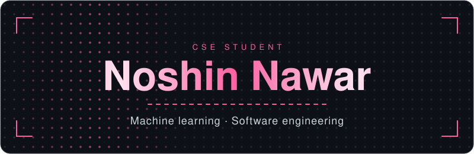

 

 

    

Hi, I'm **Noshin Nawar**, a Computer Science & Engineering student at **North South University** who enjoys turning ideas into working software.

My projects have taken me across **machine learning, computer vision, NLP, web development, and systems programming** — from recognizing Bangla sign language gestures to building an interactive operating-system simulator.

- 🎓 Studying **Computer Science & Engineering** at North South University.
- 🧠 Interested in **machine learning, computer vision, intelligent applications, and software engineering**.
- 🛠️ I enjoy building projects end-to-end — from data collection and model training to backend development and deployment.
- 🔬 Currently working on **Koi Pabo / StyleSearch BD**, an image-based fashion search system designed around the Bangladeshi market.
- 💻 Comfortable moving between **Python, web development, APIs, databases, and systems programming**.
- 🚀 Currently focused on building stronger real-world software and ML projects.
- ✨ Fun fact: **I started building because I kept wishing certain things already existed.**

 

